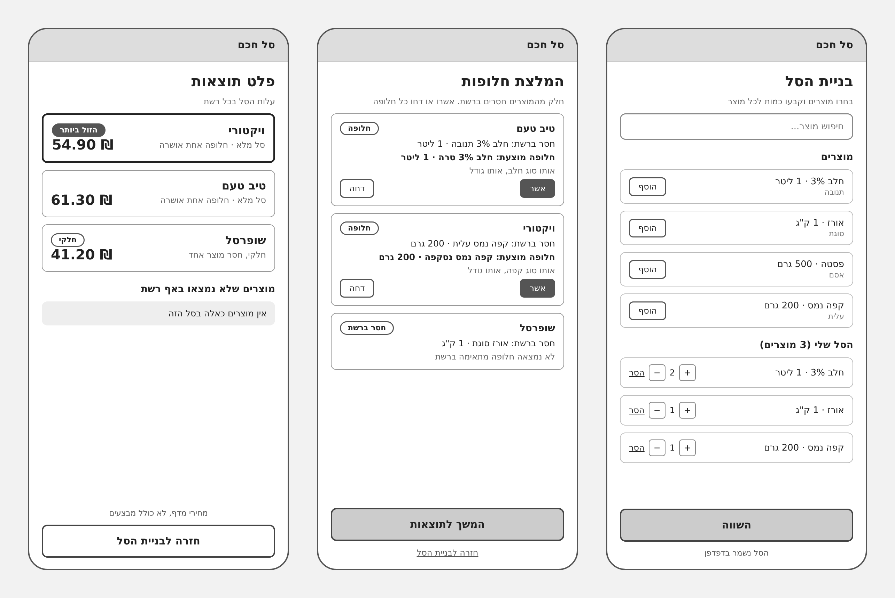
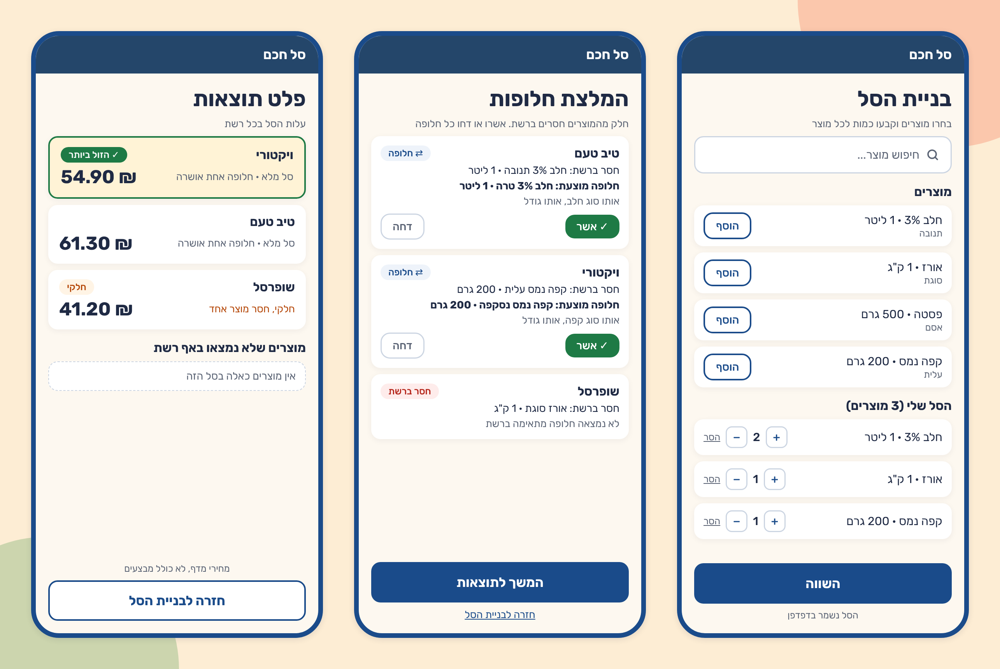
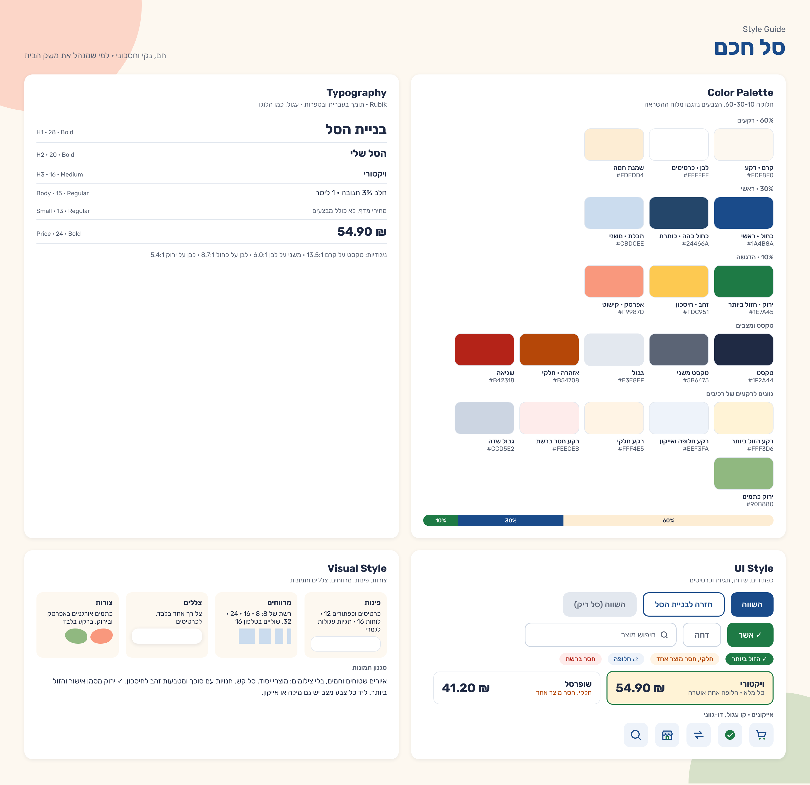

# DESIGN: סל חכם

מבוסס על `product-10-definitions.md`, `PRD.md` ושלוש התמונות. נכתב ב-20.10.2026, ועודכן ב-24.10.2026 לפי הערות המשתמש. ב-11.11.2026 עודכן לפי מה שנבנה: לוגו בכותרת, בחירת עיר, קטגוריות, סל אוטומטי, "נקה סל", "אשר הכל / דחה הכל", לוגו לכל רשת ו"הזול מבין החלקיים". תמונות הייחוס נשארו מ-20.10.2026, ולכן הן לא מראות את התוספות האלה.

## תמונות הייחוס

## 1. Screens

### בניית הסל
- המטרה: לבנות את סל הקניות ולשמור אותו לכניסה הבאה. זה המסך העיקרי, וה-Onboarding של המוצר.
- מה יש במסך:
  - כותרת עליונה ברקע כחול כהה: אייקון הלוגו (40 על 40, על רקע לבן עם פינות מעוגלות), "סל חכם" ולידו "CartWise" באנגלית.
  - כותרת "בניית הסל", ובאותה שורה, בצד השמאלי, רשימה נפתחת "עיר" (תל אביב / הרצליה). מתחת: "בחרו מוצרים וקבעו כמות לכל מוצר".
  - כפתור משני לרוחב המסך "🛒 סל אוטומטי ל[עיר]: N מוצרים".
  - שדה חיפוש עם אייקון זכוכית מגדלת, הטקסט "חיפוש מוצר..." וכפתור "✕" לניקוי. לידו כפתורי קטגוריה ("שתייה", "מזון יבש", "לחם"), ובשורה מתחת שאר הקטגוריות. שתי שורות קבועות, בלי גלילה. קטגוריה שנבחרה: כחול מלא.
  - "מוצרים": רשת של כרטיסים, שניים בשורה בטלפון ושלושה במחשב. בכל כרטיס תמונה גדולה (או איור) עם כפתור "+" בפינה העליונה, ומתחת שם המוצר, ובשורה קטנה הגודל והיצרן. הקלקה על התמונה מוסיפה לסל. מוצר שבסל: "✓" ירוק ומסגרת ירוקה (מיילסטון 7).
  - "הסל שלי (N מוצרים)": כרטיס לכל מוצר בסל, עם שם וגודל, כפתורי "+" ו-"−", הכמות ביניהם, וקישור "הסר".
  - בתחתית, בשורה אחת: כפתור ראשי "השווה", ולידו כפתור אדום "נקה סל" באותו גובה.
  - הערה קטנה מתחת לכפתורים: "הסל נשמר בדפדפן".
- מה קורה במסך:
  - חיפוש מסנן את רשימת המוצרים לפי שם, תמיד בכל הקטגוריות. הקלדה מבטלת את הקטגוריה שנבחרה.
  - בחירת עיר נשמרת בדפדפן, ומשנה את הרשתות בהשוואה ואת הסל האוטומטי.
  - "סל אוטומטי" מוסיף לסל את מוצרי היסוד שעוד לא בו. מה שכבר בסל נשאר כמו שהוא.
  - "נקה סל": לחיצה ראשונה הופכת את הכפתור לאדום מלא עם "בטוח? לחץ שוב". לחיצה שנייה תוך 4 שניות מרוקנת את הסל.
  - במוצר במשקל הכמות בק"ג, בקפיצות של חצי.
  - "הוסף" מכניס מוצר לסל בכמות 1. "+" ו-"−" משנים כמות. "הסר" מוציא מהסל.
  - כל שינוי נשמר מיד בדפדפן.
  - "השווה" לא פעיל כשהסל ריק (ב-Style Guide: אפור, "השווה (סל ריק)").
  - "השווה" מוביל להמלצת חלופות אם מוצר חסר ברשת כלשהי, ואחרת ישר לפלט תוצאות.

### המלצת חלופות
- המטרה: לאשר או לדחות מוצר חלופי לכל מוצר שחסר ברשת, בלי החלפה שקטה.
- מה יש במסך:
  - כותרת עליונה "סל חכם".
  - כותרת "המלצת חלופות", ומתחתיה "חלק מהמוצרים חסרים ברשת. אשרו או דחו כל חלופה".
  - מעל הכרטיסים, כשיש לפחות חלופה אחת: "✓ אשר הכל" (ירוק) ו"דחה הכל". כפתור שכל החלופות כבר במצב שלו מסומן כלחוץ.
  - כרטיס לכל מוצר חסר ברשת: שם הרשת, תגית, "חסר ברשת: [המוצר]", ובשורה מודגשת "חלופה מוצעת: [המוצר החלופי]", ומתחת לה הנימוק בשורה קטנה (למשל "אותו סוג חלב, אותו גודל").
  - בכרטיס עם חלופה: תגית "⇄ חלופה", כפתור ירוק "✓ אשר" וכפתור "דחה" עם מסגרת אפורה.
  - בכרטיס בלי חלופה: תגית אדומה "חסר ברשת" והשורה "לא נמצאה חלופה מתאימה ברשת", בלי כפתורים.
  - כפתור ראשי "המשך לתוצאות", ומתחתיו קישור "חזרה לבניית הסל".
- מה קורה במסך:
  - "אשר" ו"דחה" נשמרים בדפדפן, לכל רשת ומוצר בנפרד.
  - חלופה שנדחתה, או מוצר בלי חלופה, הופכים את הסל ברשת הזו לחלקי.
  - "המשך לתוצאות" מוביל לפלט תוצאות.

### פלט תוצאות
- המטרה: להראות את עלות הסל בכל רשת בעיר שנבחרה, ואיזו רשת הכי זולה.
- מה יש במסך:
  - כותרת עליונה "סל חכם".
  - כותרת "פלט תוצאות", ומתחתיה "עלות הסל בכל רשת".
  - כרטיס לכל רשת: הלוגו של הרשת (גובה 28), שם הרשת, המחיר הכולל בגדול (למשל "₪ 54.90"), ושורת מצב: "סל מלא · חלופה אחת אושרה", או "חלקי, חסר מוצר אחד" בכתום.
  - הרשת הזולה ביותר: כרטיס ברקע זהב בהיר עם מסגרת ירוקה, ותגית ירוקה "✓ הזול ביותר".
  - רשת עם סל חלקי: תגית כתומה "חלקי".
  - הזולה מבין הרשתות החלקיות שחסרים בהן הכי מעט מוצרים: תגית כתומה מלאה "✓ הזול מבין החלקיים".
  - סדר הכרטיסים: סל מלא קודם, מהזול ליקר. אחריו החלקיים, מהמעט חסרים להרבה.
  - "מוצרים שלא נמצאו באף רשת": תיבה עם מסגרת מקווקווה, שהיא ההתראה למשתמש. אם אין, כתוב "אין מוצרים כאלה בסל הזה".
  - הערה: "מחירי מדף, לא כולל מבצעים".
  - כפתור משני "חזרה לבניית הסל", עם מסגרת כחולה.
- מה קורה במסך:
  - התגית "הזול ביותר" ניתנת רק בין רשתות שהסל מלא בהן. רשת עם סל חלקי לא מקבלת אותה, גם אם הסכום שלה נמוך יותר.
  - מוצר שלא נמצא באף רשת, ואין לו חלופה סבירה, לא נכנס לסל ולאף סכום, ומופיע בתיבה הזו.
  - "חזרה לבניית הסל" מחזיר למסך הראשון, עם הסל השמור.

### ניווט בין המסכים
- בניית הסל → (השווה) → המלצת חלופות → (המשך לתוצאות) → פלט תוצאות.
- אם אין מוצר חסר באף רשת, "השווה" מוביל ישר לפלט תוצאות.
- ממסך החלופות וממסך התוצאות יש חזרה לבניית הסל.
- אין תפריט ואין מסכים נוספים. כפתור "חזרה" של הדפדפן עובר בין המסכים.
- בתחתית כל המסכים: שורת קרדיט לתמונות המוצרים, עם קישור לפירוט המלא.

## 2. Style Guide

### צבעים
חלוקה 60-30-10.

| מס' | שם | HEX | שימוש |
|---:|---:|---:|---:|
| 1 | קרם | `#FDF8F0` | רקע המסכים |
| 2 | לבן | `#FFFFFF` | כרטיסים ושדות |
| 3 | שמנת חמה | `#FDEDD4` | רקע מסביב, בלוחות |
| 4 | כחול | `#1A4B8A` | כפתור ראשי, מסגרות כפתורים משניים, קישורים |
| 5 | כחול כהה | `#24466A` | הכותרת העליונה |
| 6 | תכלת | `#CBDCEE` | משטחים משניים |
| 7 | ירוק | `#1E7A45` | "הזול ביותר", "אשר", אישור |
| 8 | זהב | `#FDC951` | חיסכון, בקישוט |
| 9 | אפרסק | `#F9987D` | כתמי רקע בלבד |
| 10 | טקסט | `#1F2A44` | טקסט ראשי |
| 11 | טקסט משני | `#5B6475` | תיאורים והערות |
| 12 | גבול | `#E3E8EF` | קווי הפרדה, כפתור לא פעיל |
| 13 | אזהרה | `#B54708` | "חלקי" |
| 14 | שגיאה | `#B42318` | "חסר ברשת" |
| 15 | רקע הזול ביותר | `#FFF3D6` | כרטיס הרשת הזולה |
| 16 | רקע חלופה | `#EEF3FA` | תגית "חלופה", רקע אייקונים |
| 17 | רקע חלקי | `#FFF4E5` | תגית "חלקי" |
| 18 | רקע חסר ברשת | `#FEECEB` | תגית "חסר ברשת" |
| 19 | גבול שדה | `#CCD5E2` | שדה חיפוש, כפתורי כמות, "דחה" |
| 20 | ירוק כתמים | `#90B880` | כתמי רקע בלבד |

- הירוק של הלוגו (`#028D54`) הוכהה ל-`#1E7A45`, כדי שטקסט לבן עליו יעבור ניגודיות של 4.5:1.
- מצב לא מועבר בצבע בלבד: לכל צבע מצב יש מילה ("הזול ביותר", "חלקי", "חלופה", "חסר ברשת").

### גופנים
Rubik, בעברית ובספרות.

| מס' | שימוש | גודל | משקל |
|---:|---:|---:|---:|
| 1 | כותרת מסך (H1) | 28 | Bold |
| 2 | כותרת אזור (H2) | 20 במדריך, 16 במסכים | Bold |
| 3 | שם רשת (H3) | 16 | Medium או Bold |
| 4 | טקסט רגיל | 15 | Regular |
| 5 | טקסט קטן | 13 | Regular |
| 6 | מחיר | 24 | Bold |

### כפתורים ורכיבים
- **כפתור ראשי:** רקע כחול, טקסט לבן, גובה 48 עד 52, לרוחב המסך. "השווה", "המשך לתוצאות".
- **כפתור משני:** רקע לבן, מסגרת כחולה, טקסט כחול. "הוסף", "חזרה לבניית הסל".
- **כפתור אישור:** רקע ירוק, טקסט לבן, "✓ אשר".
- **כפתור דחייה:** רקע לבן, מסגרת אפורה, טקסט אפור. "דחה".
- **כפתור לא פעיל:** רקע אפור בהיר, טקסט אפור.
- **שדה חיפוש:** רקע לבן, מסגרת אפורה, אייקון זכוכית מגדלת.
- **כפתורי כמות:** ריבועים קטנים עם מסגרת אפורה, "+" ו-"−" בכחול, והכמות ביניהם.
- **תגיות:** עגולות לגמרי. "✓ הזול ביותר" ירוק מלא, "✓ הזול מבין החלקיים" כתום מלא עם טקסט לבן, "⇄ חלופה" כחול על תכלת, "חלקי" כתום על רקע כתום בהיר, "חסר ברשת" אדום על רקע אדום בהיר.
- **כפתור "נקה סל":** מסגרת וטקסט אדומים. במצב אישור: רקע אדום וטקסט לבן.
- **רשימה נפתחת "עיר":** גובה 40, רקע לבן, מסגרת אפורה.
- **כרטיסים:** רקע לבן וצל רך. כרטיס הרשת הזולה: רקע זהב בהיר ומסגרת ירוקה.
- **אייקונים:** קו עגול, דו-גווני, כחול עם ירוק: עגלה, ✓ בעיגול, חיצי החלפה, חנות, זכוכית מגדלת.

### פינות, צורות ומרווחים
- פינות: 12 לכרטיסים, כפתורים ושדות. 16 ללוחות. תגיות עגולות לגמרי.
- מרווחים: רשת של 8 (8, 16, 24, 32). שוליים בטלפון: 16.
- צל: צל רך אחד בלבד, לכרטיסים.
- צורות: כתמים אורגניים באפרסק ובירוק, ברקע מסביב בלבד.

### אווירה כללית
חמה, נקייה וחסכונית, למי שמנהל את משק הבית. רקעי קרם, כחול אמין לפעולות, וירוק לחיסכון ולאישור. במקור: איורים שטוחים, בלי צילומים. מאז Milestone 7 תמונות המוצרים הן צילומי מוצר נקיים על רקע לבן (400 על 400), בלי צילומי בית או יד, ולא מאתרי הרשתות או היצרנים.

## הערות
- התמונות מראות רק טלפון, ברוחב 375. ה-PRD דורש גם מחשב. במחשב אותם מסכים, באותם רכיבים, בעמודה אחת במרכז. זו החלטה שלי, כי אין תמונה של מחשב.
- המחירים והמוצרים בתמונות הם דוגמה.
